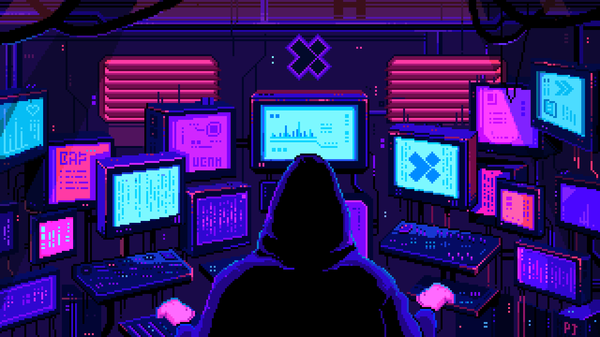
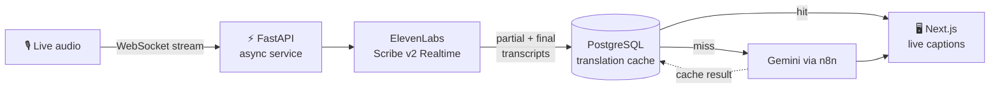
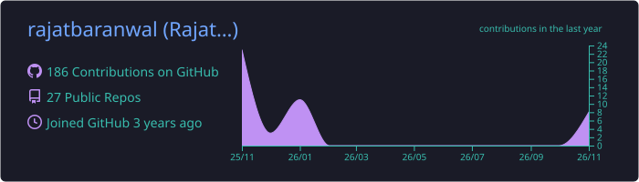
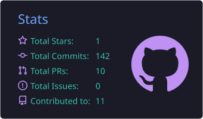
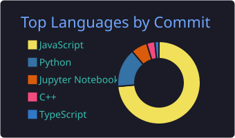

<p align="center">
  
</p>

<h1 align="center">Rajat Baranwal</h1>

<p align="center">
  <a href="https://rajat-portfolio-lime.vercel.app/">
    
  </a>
</p>

<p align="center">
  <a href="https://rajat-portfolio-lime.vercel.app/"></a>
  <a href="https://linkedin.com/in/rajat-baranwal"></a>
  <a href="mailto:rajat123baranwal@gmail.com"></a>
  <a href="https://ieeexplore.ieee.org/abstract/document/11576810/"></a>
  <a href="https://www.leetcode.com/rajat_bar"></a>
</p>

<p align="center">
  
</p>

---

### `$ whoami`

```python
class Rajat:
    role       = "Software Engineer · Backend & AI Integration"
    education  = "B.Tech CSE @ SRM University AP ('26) · CGPA 8.24 · Merit Scholar"
    experience = "SWE Intern @ XiPHI AI, Seattle (Remote) · Apr – Oct 2026"
    builds     = ["real-time speech pipelines", "FastAPI services", "LLM workflows", "full-stack apps"]
    research   = "Co-author · IEEE CI2A 2026"
    certified  = ["Oracle Certified Professional: Java SE 11", "AWS Fundamentals"]
    status     = "Open to full-time Software Engineer roles 🚀"
```

---

### 💼 Experience: Software Engineer Intern @ XiPHI AI

I worked on **[myEventz.ai](https://myeventz.ai)**, building live transcription and translation for events, and **onboard.myeventz.ai**, the attendee onboarding platform.



- ⚡ **Real-time speech-to-text**: async audio streaming over WebSockets, handling both partial and final transcription events
- 🗄️ **LLM cost control**: a PostgreSQL translation cache that skips redundant Gemini / n8n workflow runs
- 📈 **Performance**: load-tested APIs with Apache JMeter + Grafana to find failures and latency bottlenecks under concurrent load
- 🔐 **Production**: integrated Cloudflare Turnstile and fixed deployment issues across Next.js, Docker, and containers
- 🧪 **R&D**: benchmarked Faster-Whisper with audio chunking, overlapping windows, and VAD; validated QR check-in with duplicate-scan detection

---

### 🚀 Featured projects

| | Project | Highlights | Stack |
|:-:|---|---|---|
| 🚗 | **[RoadResQ](https://github.com/rajatbaranwal/roadresq)** | Connects stranded drivers with mechanics; live GPS tracking during active requests; separate customer and mechanic dashboards | MERN · Socket.IO · Leaflet · JWT |
| 🏥 | **[MediQ](https://github.com/rajatbaranwal/mediq-platform)** | Global hospital discovery with geospatial search; appointments, OPD queues, bed and blood-inventory tracking; real-time updates | Next.js · TypeScript · Express · MongoDB · Socket.IO |
| ⚡ | **[Real-Time Sales Pipeline](https://github.com/rajatbaranwal/real-time-sales-streaming-pipeline)** | Kafka producer–consumer streaming into PostgreSQL, with a live Streamlit KPI dashboard | Kafka · PostgreSQL · Python · Streamlit |

---

### 📄 Research

> **Co-author**: research paper published at **IEEE CI2A 2026** · [Read on IEEE Xplore →](https://ieeexplore.ieee.org/abstract/document/11576810/)

---

### 🛠️ Tech stack

<p align="center">
  <br/>
  <br/>
  <br/>
  
</p>

<p align="center">
  <b>AI & Speech</b>&nbsp; Gemini · ElevenLabs Scribe v2 · Faster-Whisper · VAD · n8n
</p>

---

### 📊 GitHub activity

<p align="center">
  
</p>

<p align="center">
  
  
</p>

<p align="center">
  
</p>

<p align="center">
  <picture>
    <source media="(prefers-color-scheme: dark)" srcset="https://raw.githubusercontent.com/rajatbaranwal/rajatbaranwal/output/github-snake-dark.svg" />
    <source media="(prefers-color-scheme: light)" srcset="https://raw.githubusercontent.com/rajatbaranwal/rajatbaranwal/output/github-snake.svg" />
    
  </picture>
</p>

<p align="center">
  
</p>
